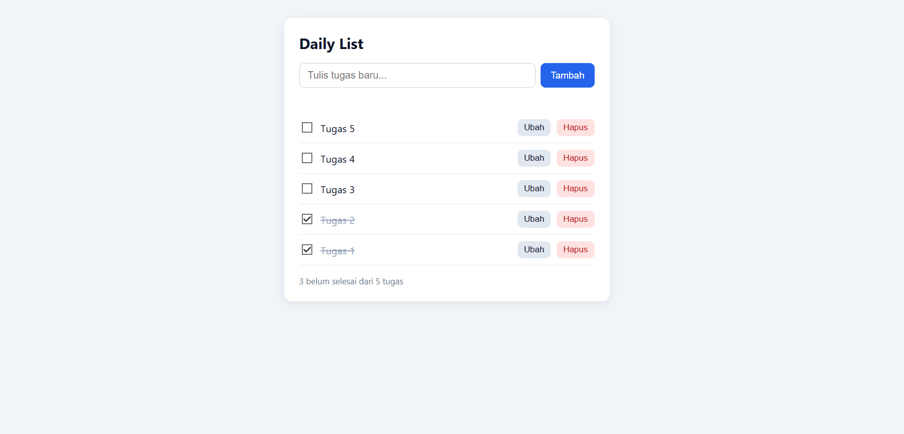
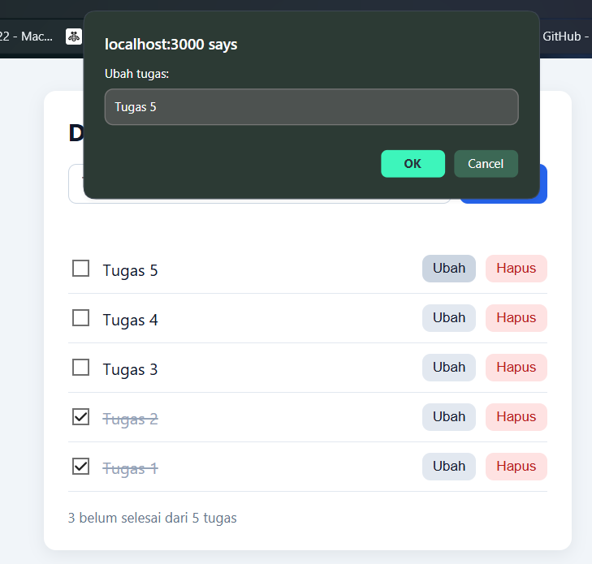
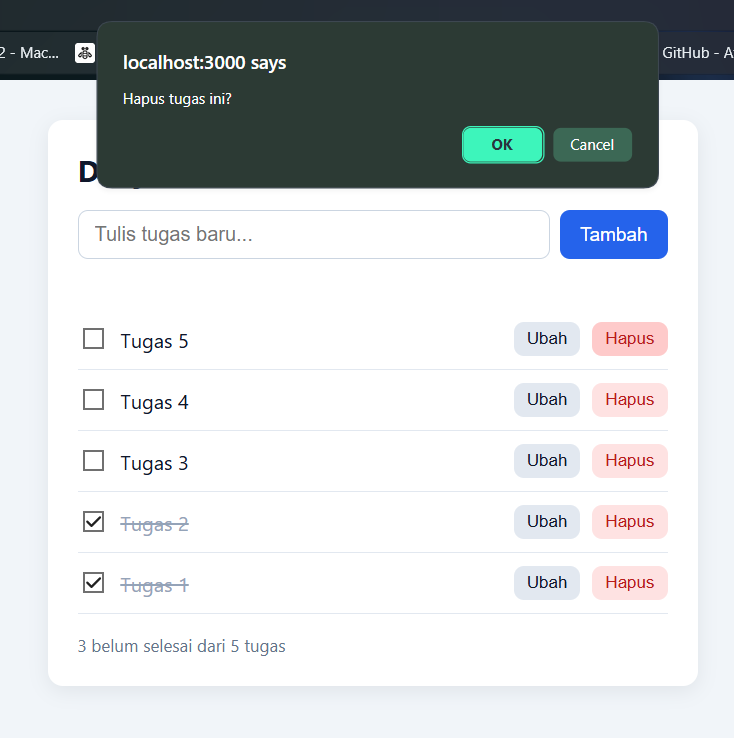

# To-Do List (Express + SQLite + HTML/CSS/JS)

<p align="center">
  
</p>

<p align="center">
  
  
</p>

- **Frontend:** HTML, CSS, JavaScript biasa (folder `public/`)
- **Backend:** Node.js + Express (`server.js`)
- **Database:** SQLite bawaan Node (`node:sqlite`), tanpa paket tambahan (`store.js`)

## Struktur folder

```
todo-app/
├── docs/
│   ├── dashboard.png   
│   ├── ubah.png
│   └── hapus.png    
├── package.json
├── server.js      
├── store.js         
├── public/
│   ├── index.html   
│   ├── style.css    
│   └── app.js       
├── test/
│   └── store.test.js
└── .gitignore
```

## Menjalankan

Node.js versi 22.13 atau lebih baru

```bash
npm install
npm start
```

Buka http://localhost:3000

## API

| Method | URL | Fungsi | Body |
|---|---|---|---|
| GET | `/api/todos` | Daftar semua tugas | - |
| POST | `/api/todos` | Tambah tugas | `{ "title": "..." }` |
| PUT | `/api/todos/:id` | Ubah judul/status | `{ "title": "...", "done": true }` |
| DELETE | `/api/todos/:id` | Hapus tugas | - |
| GET | `/health` | Cek server hidup | - |